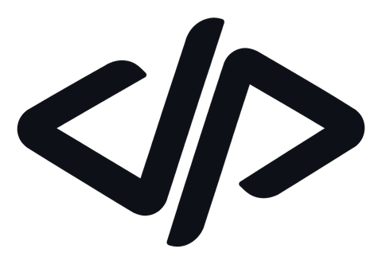

  <picture>
    <source media="(prefers-color-scheme: dark)" srcset="assets/logo-white.png">
    
  </picture>

<h1 align="center">Jean Dubois</h1>

General Manager at JD Digital Labs · Software Engineer · Lima, Peru

  <samp>
    <a href="https://labsjd.com">labsjd.com</a> ·
    <a href="https://github.com/JD-Digital-Labs">@JD-Digital-Labs</a> ·
    <a href="https://www.linkedin.com/in/jeanfrancodubois">linkedin</a> ·
    <a href="mailto:contact@labsjd.com">contact@labsjd.com</a>
  </samp>

- General Manager and co-founder of **[JD Digital Labs](https://github.com/JD-Digital-Labs)**, a software company based in Lima, Peru.
- I lead the technical side of every project, from the data model to deployment and client handover.
- Currently building multiple projects for companies across different industries.
- Final-term Software Engineering student at **ISIL**.

### What we build

- **Business systems.** Internal platforms with roles, reporting and approval flows, tailored to how each company works.
- **Mobile apps.** Native iOS and Android apps with Swift, React Native and Flutter, through to App Store and Google Play release.
- **Websites and portals.** Corporate sites, landing pages and client portals, fast and built to rank.
- **AI automation.** Assistants and agents that read documents, sort information and take repetitive work off teams.

### How I work

I follow **[Organic Driven Development (ODD)](https://github.com/Gentleman-Programming/gentle-ai#odd--keep-small-work-small)**, the methodology from Gentleman Programming.

- **Process sized to the work.** Small, well-understood changes ship directly. Larger features get one written spec that every step refers back to.
- **Understand before changing.** Every change starts by exploring the existing system and its constraints.
- **Test first.** A failing test defines the expected behavior before the code is written.
- **Software clients can run.** Technical manuals, documentation and a full handover of accounts and access.

### Certifications

- **Anthropic** — Claude Code in Action · Model Context Protocol: Advanced Topics · Introduction to Model Context Protocol · Claude with Google Vertex AI (2026)
- **Google** — AI Professional Certificate · Cybersecurity Certificate · UX Design Certificate (2026)
- **Cisco** — CCNAv7: Introduction to Networks (2024) · IT Essentials (2023)

Full list on <a href="https://www.linkedin.com/in/jeanfrancodubois/details/certifications/">LinkedIn</a>.
